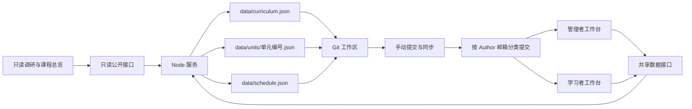

# 学习工作台：Node 零依赖改造方案

日期：2026-10-13。状态：Node 服务、文件存储、课程与学习管理界面已实施。本文记录当前结构和规则；运行方法见 [README](README.md)，实测范围见 [实施验证](docs/实施验证.md)。文件保存与 Git 提交分开，本说明不表示已提交或推送。

已确认：先在本机或可信局域网运行；后端、测试和启动只依赖 Node 内置能力；无需 `npm install`；研究图表使用仓库内的 ECharts 副本；课程和学习数据保存在仓库内；**管理页直接进入，不设置密码或登录**。通过环境变量配置学习者 Git 邮箱，匹配的提交归为学习记录，其余归为管理者维护记录；读取提交历史使用本机 Git。管理者维护课程、计划、任务提问和练习思考题。由一位学习者和一位管理者使用，共同推进三个项目。周计划按实际可用时间调整，四天学习是常态容量，不是必须补齐的出勤指标。

## 1. 已实施的结构

**一个 Node 进程 + 原生 HTML/CSS/JavaScript + JSON 文件存储。** 默认绑定 `127.0.0.1`，显式指定监听地址后提供局域网访问。服务器只读调用本机 Git 获取提交历史；文件进入工作区后，用正常的 Git 操作提交、同步和恢复。核心编辑和保存只需 Node，Git 历史功能另需本机已有 Git，不引入 npm 依赖。



Node 的 HTTP 服务、文件读写、标识生成和测试分别采用内置的 `node:http`、`node:fs/promises`、`node:crypto`、`node:test`。运行要求为 Node 22 或更新的 LTS 版本。[Node HTTP](https://nodejs.org/docs/latest-v24.x/api/http.html)、[测试运行器](https://nodejs.org/docs/latest-v24.x/api/test.html)、[支持版本](https://nodejs.org/en/about/previous-releases)。

启动与验证命令如下；已有 `.env.local` 时跳过复制：

```sh
cp .env.example .env.local                     # 本地配置，不进入 Git
node server.mjs                                # 本机使用
node server.mjs --host 0.0.0.0 --port 3000       # 明确开启局域网访问
node --test                                    # 运行测试，不下载工具
```

学习者打开 `/learner.html` 完成训练、作答与复盘；管理者打开 `/admin.html` 维护课程和计划、只读查看学习档案。两页独立组织操作，共享数据和版本检查，不构成登录或权限隔离。默认仅本机可访问；开启局域网后，能访问服务的人拥有相同的读写能力。服务启动检查数据格式；遇到损坏文件或 Git 冲突标记，指出文件并拒绝覆盖。

## 2. 学习者与管理者的独立页面

| 工作区域 | 学习者工作台 | 管理者工作台 |
|---|---|---|
| 状态 | 查看个人掌握情况、卡点与本周容量，进入当前训练 | 查看整体状态，进入对应学习档案 |
| 训练与记录 | 保存草稿、训练、题目作答、证据、AI 核验、复测和更正；维护自己的验收清单和复盘 | 只读查看原任务、题目、答案、证据、卡点与复盘；不提供代填训练或验收表单 |
| 课程与题目 | 读取当前任务要求，不提供课程编辑表单 | 新增、编辑、排序和归档阶段、单元、任务、题目及标准，保存变更并检查版本 |
| 周计划与延期 | 核对执行情况，按真实可用时间减量、续做、暂停或恢复 | 维护同一份周计划，查看原安排、核对和调整历史 |
| Git 与数据 | 查看按 Author 邮箱归类的学习提交，导出数据 | 查看维护提交，导出数据 |

两页均有深浅主题。学习者默认进入训练，管理者默认进入整体状态；首页分别提供两个入口。页间切换不会改变 Git 作者，既有记录也不迁移成两份。课程实质变更后，学习者仍需核对新的要求再继续，旧作答快照保留。

整体状态按当前有效学习项及验收版本计算，不把工时、打卡或提交数换算成技能水平。最近四周的条形对比保留原定与调整后两组分钟数，不能通过缩小计划掩盖差异。`/plan.html` 从当前课程生成 Canvas 路线，支持全屏，只做课程总览；招聘报告保留 ECharts 技能图表，不展示个人进度。

## 3. 仓库与数据文件

实际目录：

```text
Embedded/
  server.mjs                 # 启动、配置、HTTP 路由入口
  lib/
    store.mjs                # 运行锁、版本检查、原子保存
    git-history.mjs          # 只读获取 Git 提交、按邮箱分类
  shared/
    study-domain.mjs         # 可由浏览器和 Node 复用的学习规则
    schedule.mjs             # 周容量校验、顺序排程、延期预览
  public/
    index.html               # 调研与学习路线入口
    report.html              # 带采集日期的调研快照
    plan.html                # 从当前课程数据生成的只读路线
    learner.html             # 学习者训练、作答、复盘和周安排
    admin.html               # 管理者课程维护和只读学习档案
    assets/                  # 原生 JS/CSS、日程候选与加载规则
    vendor/echarts/           # 本地图表库及许可说明
    docs/                    # 带采集日期的研究 Markdown 与证据
    research/                # 50 条 JD 与技能统计数据快照
  data/
    curriculum.json          # 阶段、项目、单元、任务、题目、验收标准
    schedule.json            # 自然周容量、任务安排、调整历史
    units/
      w01.json               # 该单元的复盘、草稿、检查、记录及作答
      w02.json
  docs/
    当前学习训练计划.md       # 当前课程的按需导出结果
    实施验证.md              # 自动化与浏览器核验范围
  scripts/
    export-plan.mjs          # 从课程数据导出 Markdown，按需运行
  tests/
  .local/                    # 运行锁；Git 忽略
  .env.example               # 可复制的本地配置示例
  .env.local                 # 本地配置；Git 忽略
  .gitignore
  README.md
```

`data/` 进入 Git；`.local/` 和原子写入产生的临时文件不进入 Git。主题、选中的页签等显示偏好继续留在浏览器，不造成数据文件变更。JSON 使用稳定字段顺序、两空格缩进和文件尾换行。

**课程与记录分开，记录按单元存放。** 一次训练的“追加记录、清除草稿、更新验收信息”在同一个文件里完成。这样便于查看 Git diff，也避免每条记录一个文件造成大量碎片。

服务器成功保存只代表文件已写入工作区，尚未产生 Git 提交；提交后也还需要 push 才会到远端。首版不增加自动 commit、pull、push 或网页 Git 管理。仓库若公开，其中的个人训练记录也会公开。

Git pull、切换分支和恢复文件时先停止服务；处理冲突并通过数据检查后再启动。同一单元仍可能产生 Git 合并冲突，不能承诺自动合并学习记录。

### 3.1 用 Git 邮箱区分学习与维护

配置项为 `LEARNER_GIT_EMAIL`，本项目配置值为 `mahoo-pig@qq.com`，由服务器读取 `.env.local` 或终端环境变量；终端配置优先，修改后重启。该变量仅用于分类，不设置 Git 的 `user.email`，不改写提交作者，也不修改系统或仓库 Git 配置。学习者与管理者各自使用正确的 Git 作者身份提交；页面上点击了哪个区域不决定提交身份。

按提交对象的**原始 Author 邮箱**分类，去除首尾空白并统一小写后作完整匹配：

| Git Author 邮箱 | 历史类型 | 含义 |
|---|---|---|
| 与 `LEARNER_GIT_EMAIL` 相同 | 学习记录 | 学习者的 Git 提交 |
| 其他邮箱 | 维护记录 | 管理者的 Git 提交 |

读取 `%ae`，不使用受 `.mailmap` 影响的 `%aE`；Committer 邮箱可以作为详情显示，但不参与分类。这样管理员代为应用一个保留学习者 Author 的提交时，仍按学习者归类。[Git 提交字段说明](https://git-scm.com/docs/pretty-formats)。配置为空或格式无效时，历史区域明确显示“学习者邮箱未配置/无效”，不把全部提交静默归为维护记录；课程编辑和文件保存仍可用。修改配置并重启后按新规则重新展示，Git 对象及训练档案不变。

首版历史范围明确标为“当前 HEAD 可达的本地提交”，包含已合并分支的原始提交，按完整提交哈希去重；不使用只沿第一父提交遍历的方式遗漏合并进来的学习记录。合并提交本身也遵守相同邮箱规则，并单独标注“合并”。未合入当前分支的提交不在该视图中，浅克隆则标注历史不完整；仅覆盖本仓库，不自动采集 whatforeating 等其他项目仓库。[Git 历史范围与遍历说明](https://git-scm.com/docs/git-log)。历史经 amend/rebase 改写后，刷新时按当前提交图重新读取，不把旧哈希另存为重复学习记录。

每条显示短哈希、标题、Author 邮箱、提交时间、分类及合并标记，可分页查看。列表按提交时间展示，详情保留作者时间；两者都不代替训练记录中的实际学习日期。一个提交混有代码、课程和学习档案，也只按作者邮箱归类，不根据文件路径、提交前缀或正文猜测身份。建议维护和学习工作分开提交，但不另加命名强制规则。

这里的“学习记录”是 **Git 提交分类**；管理页的“训练记录”仍指有日期、用时和证据的结构化档案。一次提交可能保存多次训练，也可能只改 README，不能自动变成一次训练、一次出勤或验收通过。管理者提交了训练数据，Git 历史仍归维护记录；结构化训练内容则按实际数据展示，不删除、不伪装作者。学习能力状态由当前课程和有效证据计算，提交数量不参与计算。

保存成功提示“已保存到工作区，尚未由此产生 Git 提交”，不替未提交文件猜测 Git 作者；暂存也不算提交。首版不建立每条训练记录与 Git 提交的一一映射，不用服务器自己的 Git 配置猜测谁保存了网页。现有无密码模式保持不变，学习者/管理者是工作分工与历史标签，不是页面访问权限。

实现使用 `node:child_process` 的 `execFile` 调用固定的 Git 命令与参数，避免拼接 Shell；分页只接受校验过的筛选值、偏移量和条数，先分类再分页。读取有每条命令 5 秒、请求总计 12 秒、8 MiB 输出及 20,000 条提交上限，超限明确报错，不把部分历史当作全部。分类不写回数据文件，不维护另一份提交数据库。没有 Git、尚未初始化仓库、尚无提交或读取失败时分别提示，保留学习功能，不自动初始化仓库、不伪造历史。

## 4. 课程可编辑以后，历史不能跟着变形

旧模型曾将完整计划与固定单元数绑定，且仅凭布尔清单判断验收。现已改为稳定标识、按单元保存和验收版本，以下调整已落地：

| 旧结构 | 当前结构 |
|---|---|
| 阶段在前端写死 | `stages[]` 配置阶段标题、顺序和说明 |
| `w01`、`w01-s1` 看起来与排序绑定 | 保留已有 ID，但 ID 永久稳定；显示序号由排序产生，重排不改 ID |
| 每单元固定四个任务，最后一个用于验收 | 初始仍保留四次训练，允许增减任务；用 `acceptanceTaskId` 明确指定独立验收任务 |
| 三项布尔数组清单 | `criteria[]` 各有稳定 ID，勾选按标准 ID 保存，数量可调整 |
| 历史标题取当前课程 | 正式记录保存当时任务的简短快照；验收记录附标准快照 |
| 所有单元计划必须同时存在 | 首次进入新单元可得到空态，第一次保存时才创建对应文件 |

每个单元使用 `assessmentVersion`：

- 改名称、调整排序、改变所在阶段，不撤销既有验收。
- 改任务步骤、产物、验证方法、验收标准、指定验收任务，或增删有效任务，由服务器递增版本；保守地进入待复核，避免自动断言“还是掌握了”。
- 记录与验收勾选保存所依据的版本。旧证据始终可读，新版要求不能被旧版通过记录自动满足。
- 仍在当前计划中的任务，其未解决问题继续保留，修改课程版本不会自动关闭卡点；优先显示待解决，无未解决问题但缺新版验收证据时显示待复核。

课程调整只需要写课程文件；状态在读取时由当前版本与已有记录计算，不必把全部档案批量改写。没有训练记录、周安排及历史引用的错误项才可以物理删除；存在任一引用的任务/单元采用归档。归档内容不进入当前计划分母，但仍有历史入口，也不能被用来掩盖当前版本未完成的验收。

首版允许单元内任务排序、单元调整阶段；已有训练记录、周安排或历史引用的任务暂不跨单元搬移，避免档案和日程引用失配。正式过程记录追加更正时关联原记录 ID 并说明原因，原记录保留但统计只使用其有效更正版本，避免重复计时。普通复测则是一次新的实际训练，单独计时。新问题继续沿用“普通练习不关闭卡点，后续同任务复测通过才关闭”的规则。

### 4.1 管理任务提问和练习思考题

管理者在当前任务的编辑页维护两类题目，共用一个简单编辑器：

| 类型 | 用途 | 示例 |
|---|---|---|
| 任务提问 | 引导执行前预测、执行中观察、执行后解释，围绕当前任务 | “输入字母后读取函数返回什么？哪些变量此时不能继续使用？” |
| 练习思考题 | 通过边界变化、故障定位或小改动检查理解与迁移 | “whatforeating 的菜品集合为空时会发生什么？先列边界用例，再修改并验证。” |

编辑器支持新增、修改、上移/下移、归档和预览；维护题干、分层提示、参考要点，并可关联一个现有验收标准。首版以文本和代码块呈现，参考要点默认折叠，学习者先作答再展开自查。当前任务的步骤、输出、验证方法也在同一页面维护，不要求跳出去编辑 JSON。

课程在任务下增加 `questions[]`，每题最小字段为稳定 `id`、`kind`（`task-prompt` / `reflection`）、`prompt`、`hints[]`、`referencePoints[]`、`version`、`archived`，数组顺序就是展示顺序；可选 `criterionId` 关联本单元的一条验收标准。不另建独立题库、考试系统或聊天线程。

学习者的草稿与正式作答存入对应 `data/units/<id>.json`；正式训练记录可带 `answers[]`，每项保存 `questionId`、`questionVersion`、当时题目快照（题干、提示、参考要点及标准关联）、答案和证据。AI 帮助与核验说明沿用该次训练记录的字段。同一题可以再次尝试，按记录顺序展示；不把正式答案放回课程定义，也不在题目表上覆盖“最后答案”。每次训练的用时只在外层记录一次，不按回答题数重复累计。

题目版本与单元验收遵守以下规则：

- 题干、提示、参考要点或验收标准关联修改时递增题目 `version`，正式答案保存的旧快照保持不变；仅排序不递增版本。旧版草稿提交时须提示题目已更新，保留输入供比较，不能当作新版答案直接提交；已归档题目不能继续提交新答案。
- 未关联验收标准的练习题，新增、修改或归档只影响题目本身，不撤销整个单元已通过状态。
- 关联验收标准的题目，新增/变更/移除关联，或修改题干、参考要点、归档题目时，递增所属单元的 `assessmentVersion`；旧证据进入待复核。单纯增补提示不改变验收结论。
- 提交答案只表示保存了一次作答，不能自动判为正确。与标准关联的题目要有符合当前验收要求的回答证据，并继续满足原有标准检查、独立验收与卡点复测规则；单纯提示更新不使已有有效答案作废，不能只因题目 `version` 不同就撤销验收。参考要点展开与答题数量都不构成通过依据。
- 已有作答、草稿、日程或其他历史引用的题目只能归档，仍可从原记录查看；不允许通过删除或移动题目使答案失去上下文。已有引用的题目暂不跨任务搬移。

初次转换保留现有步骤、验证方法和常见错误，不把它们自动当成已经设计好的试题，也不生成虚构答案。题目从空列表开始，由管理者逐项维护；学习者临时产生的疑问继续写入原有卡点与下一步字段。

## 5. 未完成本周任务时，怎样安排下一周

### 5.1 学习单元与自然周分开

旧课程的 `weeks` 实际表达一组学习任务。当前课程字段使用 `units`，保留 `w01` 等稳定 ID；界面统一称“单元”。自然周单独按 `Asia/Shanghai` 的周一至周日计算，用周一的 `YYYY-MM-DD` 作为标识，不把单元编号当作日期。

一个单元默认四次训练，可以跨多个自然周；一次较大的任务也可以分成多个学习时段。每周四天、每天两到三小时只是正常情况下的容量。已掌握内容可以独立验收，通过当前标准且没有未解决卡点后，免做重复练习，不伪造四次出勤或工时。32 个单元不能直接承诺为 32 个自然周完成。

**科学依据与产品取舍分开。** 学习研究支持分散练习和练习测试，因此恢复学习时安排短自测、继续保留独立验收，比仅凭花费时间判断掌握更有依据。[Dunlosky 等，2013，研究综述及摘要](https://www.psychologicalscience.org/journals/pspi/1529100612453266/)。下述容量约束、缓冲和提醒阈值是面向这个学生的管理设计，尚未经过个人效果验证；不把它们称为经过实验证明的最优排程算法。

### 5.2 统一入口：周计划与延期

可以在周末或发现本周时间不够时打开，不等到任务全部逾期才处理。界面分三步：

1. **核对本周。** 列出已有记录、未完成任务与未解决卡点。用户确认哪些已做、部分完成、尚未开始，并填写一句原因和具体下一步。没有记录的任务标为“待核对”，不能自动认定没学；实际做过的内容可以补记真实日期与证据。核对本身不产生验收通过记录。
2. **填写未来容量。** 选择下一周真正可用的日期、时段和分钟数；提供“常态四次 / 减量两次 / 本周暂停”快捷选项，均可修改。暂停允许零时段，恢复日期可留空。剩余工作量由用户重新估计，不能直接用“原预计时长减去已花时长”。
3. **预览并应用。** 展示继续做什么、新内容推迟到哪里、保留多少缓冲、哪些暂未安排。用户确认后保存一条调整历史。预览期间不改正式计划，不改已有训练记录。

部分完成时把下次目标写成可执行的范围，例如“补损坏历史文件的错误处理并复测”，而不是再次安排整个“实现文件保存”。可以写一句恢复提示：“下次开始先运行损坏文件样例，再定位读取失败分支”。普通暂停无需填写复杂表单。

### 5.3 排程规则

| 情况 | 系统建议与约束 |
|---|---|
| 有未完成的核心工作 | 优先续做当前任务、处理卡点和必要复测，有余量才加入新内容；同一时间只推进一个主项目 |
| 剩余任务装不进可用时段 | 拆成有明确产物的工作片段，仍引用同一个任务 ID；不把“拆完”当成“完成” |
| 新旧任务合计超出容量 | 先取消可选扩展，再推迟新的核心工作；不压缩验收、不自动增加学习天数或每天时长 |
| 考试或活动导致零容量 | 保存暂停周，保留已有代码、证据和实际用时；不强制安排碎片学习，不累计“欠八次训练” |
| 暂停后恢复 | 先用一个短检查确认能否解释或复现最近成果；检查计入当周容量，有遗忘就先补相应部分 |
| 连续两次已核对的有学习安排周仍有未完成 | 提示检查任务范围、时间估计或技术卡点，并建议减量、拆解或求助；暂停周与未核对周不计入该提示 |
| 当前单元已通过独立验收 | 免除重复练习，展示依据；真实学习天数、实际用时保持原值 |

“连续两次”的提醒门槛可调整，仅是产品默认值；延期没有扣分，不据此判断能力下降。用户没有确认的日历周不自动结算，计划也不会每天自动向后滚动。

每个时段满足：**安排片段的预计分钟数 + 复习/检查分钟数 + 缓冲分钟数 ≤ 可用分钟数**。复习若已经作为片段列出，只计算一次。缓冲由用户调整，示例中的 30 分钟不是固定科学比例。日程重叠或过量时必须先调整，再应用；总容量为零时不计算完成率。实际耗时可以超过估计，仍如实保存，不能为了配合计划截断工时。

首版按用户维护的主线顺序提出建议，当前单元未验收时不自动加入后续单元的新学习任务；独立验收允许提前。现有自然语言 `prerequisite` 只作为检查提示，不假装能解析成依赖图。首版不实现跨项目并行排程或通用依赖图求解器。

只安排已经确认容量的近期日历；未排入的任务留在课程队列，不复制成额外欠账。远期保留课程单元顺序和工作量，不把全部未来日期机械加一周。当前不设置自动平移的项目截止日期，也不改动毕业、考试等外部日期。

### 5.4 保留调整前后的依据

`data/schedule.json` 集中保存自然周安排与历史，跨周调整只改这一个文件：

| 内容 | 最小字段与规则 |
|---|---|
| 文件 | `schemaVersion`、`revision`、`timezone`、`weeks[]`、幂等回执 `receipts[]` |
| 自然周 | `weekStart`、`revisions[]`、`reviews[]`；第一版是原定计划，最后一版是当前安排，旧版不可覆盖 |
| 每次核对 | 核对时间、所依据的安排修订 ID、各片段执行情况（完成/部分完成/未开始/待核对）、下一步与关联记录 ID；追加保存，可更正但保留原核对 |
| 每次调整 | 稳定 `id` / `requestId`、`createdAt`、原因、容量与安排的完整快照、相关来源安排 ID；暂停可附预计恢复日期 |
| 学习时段 | 稳定 ID、日期、开始时间、可用分钟数、缓冲分钟数、`items[]`；零时段表示暂停 |
| 工作片段 | 稳定 ID、`unitId` / `taskId`、本次目标、重新估计的分钟数、可选 `continuedFromItemId`；同一片段不能同时占两个时段 |
| 暂未安排事项 | 来源片段 ID、任务 ID、下一步、剩余估计；重新安排后引用原事项，不能再重复加入队列 |

课程定义保存在 `curriculum.json`；能力状态和实际用时来自单元档案，周安排不再存另一套“已验收”布尔值。周核对只说明安排执行情况，不能代替独立验收；由 `schedule/apply` 一并保存，也允许先只保存核对、暂不安排下周。训练记录可关联 `scheduleItemId`，但仍记录真实训练日期，跨周续做不会改写过去。调整页面分别展示原安排、当前安排和实际记录，不能通过删减计划隐藏当周发生过的变化。

调整尚未发生的多个日历周时，在同一文件中一次追加所有受影响周的修订；已经过去的原安排保留，通过后续片段的来源关联展示去向。课程归档后，尚未执行的关联安排提示移除或替换，历史引用仍可查看，不能静默消失。

延期只改安排，不递增 `assessmentVersion`，也不撤销已通过的能力状态。应用预览时校验计划、课程和相关记录版本；期间发生验收、课程变更或另一个标签页调整，返回冲突并要求重新预览。用稳定提交 ID 保证重试不会重复移动任务。无需引入后台定时器、AI 排程或第二套进度数据库。

### 5.5 用具体场景检查规则

以下时长是演示输入，实际需依据任务估计：

| 场景 | 下一步安排 | 必须保留的事实 |
|---|---|---|
| 本周完成前三项，第四项未做；下周仍有四天 | 第一个合适时段先排第四项验收，其余先留缓冲/待安排；验收通过后再安排新单元，不叠加成五项必做 | 原来的三项成果保留；调整不改变当前验收结论 |
| 本周 S1、S2 完成，S3 部分完成；下周只有两次各 150 分钟 | 第一次：15 分钟恢复检查 + 105 分钟完成 S3 剩余目标 + 30 分钟缓冲；第二次：120 分钟 S4 验收 + 30 分钟缓冲。若 S3 仍卡住，第二次改为续做/求助，验收继续待排 | 300 分钟容量没有变成 600 分钟；S3 原记录与已花时间继续保留 |
| 连续两周准备考试，可用时间为零 | 两周暂停；恢复周先确认容量，再安排短检查与续做 | 没有补八天的要求，没有伪造的失败记录 |
| 只用一天便独立通过当前标准且无未解决卡点 | 单元正常验收，省略重复练习，按真实余量继续 | 不为了凑四天拖延，也不把未做练习标成实际做过 |

## 6. 保存方式与接口

学习数据以服务端文件为准，前端通过同源 API 读取与保存。网络失败时保留编辑内容并明确显示“未保存”；不自动切回另一套 localStorage 正式数据库。草稿也可保存到对应单元文件，页面偏好仍只留浏览器。

保存流程为：校验请求来源与输入 → 进入单进程写队列 → 重新读取并比对版本 → 写同目录临时文件、同步并关闭 → rename 替换 → 返回成功。对同一文件未经等待的并发写入需要避免，这是 Node 文件 API 明确提示的使用限制。[Node 文件读写说明](https://nodejs.org/docs/latest-v24.x/api/fs.html#fspromiseswritefilefile-data-options)。

每个资源返回内容版本标识；更新时携带 `If-Match`。第二个标签页提交旧版本时返回冲突，保留用户输入并提示重新载入比较。追加记录带稳定提交 ID，断网重试相同请求不会重复记录工时。相同提交 ID 携带不同内容时拒绝，已经成功的相同请求重试返回原结果，不因版本已经递增而重复执行。课程修改、训练提交和排程调整共用写队列，并检查所依据的版本。一个数据目录只允许运行一个写入服务。

这是一套小型文件存储，不声称具备分布式数据库或任意断电下的事务保证。进程故障与磁盘错误仍需通过实际故障测试、文件校验和 Git/备份恢复验证。

学习者页、管理者页及数据 API 无登录与密码，直接可用；`admin` 只是管理功能的路径名。保留 Host 白名单，写接口仅接受同源 Origin 和 JSON 请求，不开放跨域写入，避免其他网站误操作本地服务。这些检查不区分局域网使用者权限。

静态文件从明确的 `public/` 范围提供；另仅开放浏览器复用的 `/shared/study-domain.mjs`，其余源码不开放。拒绝路径穿越，不直接提供 `data/`、`.local/`、`.git/` 或仓库根目录；数据通过经过校验的接口读写。

已实施的接口：

| 接口 | 用途 |
|---|---|
| `GET /api/catalog` | 提供适合公开的课程字段，不返回个人记录 |
| `GET /api/admin/overview` | 学习统计、卡点、本周容量及最近四周用时对比 |
| `GET /api/admin/curriculum`、`PUT /api/admin/curriculum` | 管理完整课程、任务提问与思考题，保存检查版本 |
| `GET /api/admin/units/:id` | 单元档案与历史 |
| `PATCH /api/admin/units/:id` | 保存草稿、复盘与检查项 |
| `POST /api/admin/units/:id/records` | 追加训练、作答、复测或更正记录 |
| `GET /api/admin/schedule` | 查询周容量、当前安排与调整历史 |
| `POST /api/admin/schedule/preview` | 按容量生成初次安排或延期调整预览，不写文件 |
| `POST /api/admin/schedule/apply` | 校验预览依据并保存安排，返回含修订与回执的周安排文件 |
| `GET /api/admin/history` | 只读查询 Git 历史；筛选全部/学习记录/维护记录，返回当前范围与分类邮箱 |
| `GET /api/admin/export` | 导出当前课程、已保存单元档案和周安排 |

写入请求携带资源 `If-Match`；单元 PATCH 与追加训练同时携带 `X-Curriculum-Version`，旧页面不能把旧标准的证据写成新版通过。API 根据资源类型限制字段与大小，ID 不能直接作为任意文件路径使用。题目关联的验收标准必须是所属单元内有效的标准；归档、移动和删除时检查所有引用。服务器计算验收状态，不信任客户端上传的“已完成”结论。

## 7. 前端资源和现有文件如何处理

表单、导航、课程、周安排和记录使用原生 JavaScript，不需要打包器。研究图表使用 `public/vendor/echarts/` 中的固定副本，保留许可证和来源；服务与管理操作不依赖 CDN。共享学习规则位于 `shared/study-domain.mjs`，浏览器控制器位于 `public/assets/`。

真实 50 条 JD 数据、原始证据与统计口径继续保留。浏览研究报告的唯一 HTML 入口为 `/report.html`，根目录重复报告 HTML 已移除。`render_learning_report.py`、`learning_report_template.html`、`visuals.html` 只保留为历史研究快照的生成源码，不属于当前运行链，也不要用来覆盖当前入口。

原 `study-core.js`、`study-workspace.js`、`study-curriculum.json`、学习页模板、学习页 Python 生成器、旧学习 HTML 及两份旧测试已由新实现替代并移除。当前课程路线和管理页读取同一份课程 JSON，避免修改课程后总览仍显示旧计划。`node scripts/export-plan.mjs` 按需生成带来源与导出时间的 `docs/当前学习训练计划.md`，不是第二份可编辑课程。根目录及 `public/docs/` 的研究文档保留采集时口径，只更新当前管理入口和快照说明。

原 32 单元已转入 `data/curriculum.json`；自然周和训练记录不预造出勤、答案或延期历史。当前范围未使用旧版正式记录，因此不增加迁移框架或兼容存储；浏览器中可能存在的旧数据不会被自动清空。

## 8. 实施结果与验证

1. **服务与文件保存已实施。** Node 可直接启动、直接进入管理页；初始课程转换、JSON 校验、数据目录单进程锁、写队列、版本冲突控制、原子替换、幂等请求和数据导出已接入。
2. **管理工作流与延期处理已实施。** 动态阶段、单元、任务、题目与标准使用稳定 ID；归档保留引用；训练有草稿、答案快照、验收版本、复测与更正链。自然周容量、预览、暂停、恢复检查、来源片段和修订历史与真实学习记录分开。
3. **Git 历史与展示已实施。** 按环境变量分类 Git 提交；路线读取当前课程；保留研究图表，提供本周与四周对比、深浅主题、窄屏布局、全屏路线、Markdown 导出及启动说明；被替代的学习页和存储路径已移除。

自动化使用 `node --test`，覆盖领域规则、自然周安排、前端日程候选规则、临时 Git 仓库，以及真实 HTTP 和文件系统组合。单元切换的慢响应与失败保护通过实际浏览器核验。以下保留为验收范围；具体通过结果以 [实施验证](docs/实施验证.md) 为准，不把规则陈述当作所有环境均已验证：

- 管理页与 API 可直接使用；不允许的 Host/Origin 和非 JSON 写请求被拒绝；静态路径穿越、直接访问数据或 Git 路径失败。
- 新增单元不破坏已有记录；重排不串任务；变更标准显示待复核；归档后历史可读。
- 题目新增、排序、修改与归档可用；旧答案显示原题快照，当前题目显示新版本；可选思考题修改与单纯增补提示不撤销单元验收，关联验收的实质变化进入待复核。
- 题目修改和作答交错时旧页面不能提交成新版答案；归档及删除检查覆盖草稿和历史引用；多题同次作答只计一次训练工时，题干/代码/提交标题按文本展示，不能执行其中的 HTML。
- 学习者 Author + 管理者 Committer 仍归学习记录，反向组合归维护记录；大小写及首尾空白按约定匹配，混合文件提交、合并提交和修改邮箱配置均遵守同一规则，不受 `.mailmap` 干扰。
- Git 合并历史不遗漏或重复原提交；未提交和暂存不伪装为已提交；空仓库、非仓库、浅克隆、无 Git、配置缺失和读取失败分别展示真实状态，不影响文件保存，也不把错误当成零条历史。
- 两个标签页交错保存产生明确冲突；重复提交不重复计时；课程变更与验收提交交错时不会误判新版通过。
- 按第 5.5 节覆盖完整、部分完成、减量、暂停和提前验收；延期不复制课程任务、不清零工时、不改变验收版本、不跳过卡点。
- 原安排与调整历史均可追溯；连续调整不重复加入待排事项；未核对记录不被算作失败，零容量周不出现除零或必须补课提示；实际超时仍完整保留。
- 排程预览后发生课程归档、验收或另一标签页修改时，应用被明确拒绝且保留输入；响应丢失后相同请求只生效一次，相同 ID 不同内容被拒绝。
- 跨月、跨年及不同时区浏览器仍按上海周一划分自然周；时段重叠、超容量、失效任务引用均有可操作提示；修改未来安排不篡改过去的训练日期。
- 写盘失败保持原文件，页面不报假成功；响应丢失后重试可确认原保存；服务重启仍能读取记录。
- 损坏 JSON、Git 冲突标记、缺失关联均能指出问题，不用空默认值覆盖。
- 干净 checkout 后无需安装依赖即可运行、编辑、保存和重启恢复；新建记录后 Git diff 只出现相应数据改动，不含运行文件或页面偏好。
- 实际浏览器检查课程与题目编辑、作答历史、Git 分类筛选、卡点复测、延期预览与取消、应用后刷新、深浅主题及窄屏；阻断 CDN 后核心操作仍可用。

首版保持单学习者、单写入进程。管理者负责内容、题目与计划维护；Git 邮箱仅用于提交分类，没有账号体系、多人实时协作、自动 Git 同步、后台定时排程或整库导入覆盖。测试数据放在临时目录，不给正式学习数据制造记录。Git 只保护已经提交的数据；文件备份与恢复步骤见 [README](README.md)。
