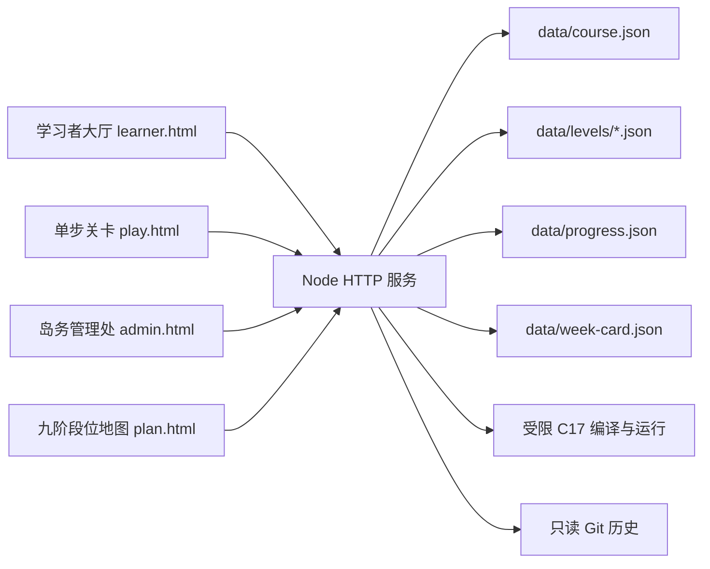

# 蛋仔编程乐园：Node 零依赖实现

日期：2026-10-13。本文描述当前 v2 实现。运行方法见 [README.md](README.md)，已执行的验证与边界见 [docs/实施验证.md](docs/实施验证.md)。这里的“零依赖”指应用启动、页面与基础自动化测试无需安装 npm 包；代码高亮采用随项目同源提供的 highlight.js 浏览器 ESM，不增加安装或打包步骤。前三段的真实 C 执行仍依赖 macOS 自带的 Clang 与 `sandbox-exec`。

## 1. 产品与领域边界

系统供一位学习者和一位管理者在本机或可信局域网中使用，不提供公开注册、登录或角色权限。学习者页、关卡页和管理页只是不同操作入口，访问服务的人可以打开全部入口。

旧的三项目课程已经被九阶段位课程完整替代。九阶指九个全局段位，当前课程沿这条段位线推进，每个段位绑定一组技术：

1. 鹌鹑蛋：C 的运行、输入输出与错误观察；
2. 鸽子蛋：C 的数据、类型、表达式与状态；
3. 鸡蛋：C 的条件、循环、函数与路径；
4. 鹅蛋：C 的内存、文件与系统化调试；
5. 鸵鸟蛋：STM32 与外设；
6. 恐龙蛋：Linux C、进程、管道、信号和恢复；
7. 巅峰凤凰蛋：C++ 工程与多线程；
8. 超级凤凰蛋：C 网络、C++、SQL 与 SQLite；
9. 无敌凤凰蛋：独立架构与跨领域整合。

前三段各有三个互动关卡和一个综合 Boss。后六段每段只有一件主题作品，作品拆成递进章节，最后通过综合挑战晋段。练习发放经验，首次独立完成未见过的变式发放星星，Boss 发放段位信物；失败不会扣除已有奖励或降段。查看完整答案后，当前变式不发星，系统改派未见过的等价变式。复制 AI 导师上下文不扣奖励，也不保存外部对话正文。

## 2. 运行结构



服务使用 `node:http` 提供静态文件和同源 JSON API，使用 `node:fs/promises` 读取与原子替换文件，使用 `node:crypto` 生成请求和记录标识，测试使用 `node:test`。页面为原生 HTML、CSS 和 JavaScript，不需要构建步骤。

主要模块：

```text
server.mjs                     HTTP、路由、校验、课程拆分保存
lib/store.mjs                  运行锁、写入队列、ETag、原子保存
lib/c-runner.mjs               入门 C17 编译、隔离运行和资源上限
lib/git-history.mjs            只读读取本地 Git 历史
shared/park-domain.mjs         课程、进度、奖励、晋段和周卡规则
data/course.json               课程索引与公共定义
data/levels/*.json             关卡、Boss 与作品详情
data/progress.json             一位学习者的实际进度与不可变奖励账本
data/week-card.json            本周游玩卡与保存回执
public/learner.html            大厅、段位地图、荣誉墙、本周游玩卡
public/play.html               一次只呈现一个学习步骤
public/admin.html              进度、自检、作答、作品和课程管理
public/plan.html               九阶段位课程总览
public/report.html             2026-10-12 历史招聘调研快照
scripts/export-plan.mjs        生成当前课程 Markdown
```

## 3. 数据模型与不变量

`course.json` 保存 `courseId`、发布版本、术语、学习规则、运行环境、11 个乐园建筑、12 件道具、9 个段位、关卡索引、作品索引、奖励和成就定义。每个关卡或作品的完整内容保存在 `data/levels/`，课程加载时必须完整水合并校验；索引与详情的编号、版本和镜像字段发生漂移会拒绝启动或保存。

`progress.json` 保存当前位置、经验、各段位状态、尝试记录、作品战利品、奖励账本和成就墙。经验、星星、Boss 信物和成就从不可变尝试记录与奖励账本中推导；重复请求、重复完成同一步骤或伪造聚合值不能重复发奖。兼容的课程修订会保留已经获得的奖励。

`week-card.json` 保存一周的一个主要目标、可选短关卡或休息状态。休息周允许零目标，不产生逾期债务或补课要求。写入带 revision 和内容指纹回执：同一内容重试返回已有结果，不同内容基于旧 revision 保存时返回冲突。

课程管理保存时使用 ETag 与 `If-Match`。内容发生实质变化时，相关关卡或作品版本和课程发布版本递增。已经有进度引用的活动不能直接删除。课程索引和详情先经过领域校验，再写入完整的数据暂存目录；服务通过目录交换一次发布全部文件，避免索引与详情只更新一半。

## 4. 学习与反馈流程

入门关卡的设计顺序为：直接体验 → 预测 → 运行观察 → 简明解释 → 引导操作 → 即时反馈 → 独立变式 → 延后重现。页面一次只展示当前步骤，避免将完整任务说明一次性堆在视口内。

服务端负责判断可自动判定的步骤。C 代码步骤会真实编译和运行，并使用 stdout、编译结果或运行状态参与判定；客户端提交的 `passed` 不能替代服务端判定。后六段作品由章节检查、证据和独立完成声明推进，目前不具备对 STM32 真机、Linux 多进程、线程、网络或数据库成品的全自动语义验收，管理页用于查看过程和自检记录。

提示分层记录。独立变式的完整答案不会随大厅或关卡初始响应下发；三层提示之后，服务先持久化 reveal 事件，再只返回当前变式的解法，替换变式仍保持脱敏。查看完整答案不会扣除已有经验或星星，但该变式失去授星资格；系统返回新的等价变式，独立完成后仍可获得这一星。每个请求带稳定 `requestId`，相同 reveal 请求重放仍返回同一答案而不会新增记录。

## 5. C 运行器边界

当前 `lib/c-runner.mjs` 面向前三个段位的小型 C17 练习：

- 编译命令使用 `/usr/bin/clang -std=c17 -O0 -Wall -Wextra -fno-common`；
- 只允许 `#include <stdio.h>`；
- 静态拒绝文件、网络、子进程、动态加载、内存映射、系统调用和内联汇编等接口；
- 源码上限 32 KiB，stdin 上限 8 KiB，stdout 与 stderr 合计上限 64 KiB；
- 编译时限 8 秒，运行时限 3 秒；
- 每次请求在独立临时目录中编译，运行后删除目录；
- 编译与运行都经 `sandbox-exec`：编译阶段只允许写入本次临时目录，运行阶段禁止文件写入；两阶段都禁止网络并限制读取用户目录、外部卷和系统配置目录，运行阶段另外禁止 `fork` 与 `exec`。

这些限制用于个人学习服务的入门题，不能把它描述为可承载不可信公网代码的通用沙箱。服务本身也没有公开账号和隔离机制，因此不得直接暴露到公网。

## 6. HTTP 与文件一致性

主要接口如下：

| 方法与路径 | 用途 |
|---|---|
| `GET /api/play/home` | 大厅、进度、当前内容、周卡和最近奖励 |
| `GET /api/play/levels/:id` | 读取一关或一件段位作品 |
| `POST /api/play/attempts` | 提交并由服务端判定互动关卡 |
| `POST /api/play/project-attempts` | 保存作品章节或 Boss 自检 |
| `PUT /api/play/week-card` | 保存本周游玩卡或休息周 |
| `GET /api/admin/state` | 管理页读取课程、进度、周卡与版本 |
| `GET/PUT /api/admin/course` | 读取或带 ETag 保存课程 |
| `GET /api/admin/export` | 导出课程、详情、进度与周卡快照 |
| `GET /api/admin/history` | 只读查看本地 Git 提交历史 |

服务默认只绑定 `127.0.0.1`。所有请求验证 Host，写请求必须为同源 JSON；静态文件解析真实路径并拒绝目录穿越。常规页面使用禁止内联脚本和样式的 CSP；历史调研页因保留原来的单文件图表实现，单独允许内联脚本和样式。

所有正式写入经过同一个进程内队列。进度和周卡等单文件写入使用同目录临时文件替换；课程多文件写入先复制、修改并校验完整暂存树，再将 `data/` 交换为新版本。交换中断时服务只在能唯一确定备份时恢复；若当前树已损坏而备份有效，会把损坏现场保留为 `.data-rejected-current-*` 后再启用备份。一个数据目录只能运行一个持锁服务。启动会先完整读取和校验核心 JSON；损坏、冲突标记、符号链接或引用不一致时不会用默认空数据覆盖现场。

这个方案不提供多实例分布式事务。文件写入成功也不等于 Git 已提交或推送；Git 同步、长期备份和人工合并冲突仍由使用者在服务停止后完成。

## 7. 管理与研究资料

管理页可查看尝试是否通过、提交的答案或代码、提示和完整解法使用情况、奖励、作品战利品、成就墙、本周目标和 Git 历史，也可修改段位与活动内容。它不会自动替学习者完成自检，也不把经验值当成掌握程度的唯一证据。

Git 历史按 `.env.local` 中的 `LEARNER_GIT_EMAIL` 与提交的原始 Author 邮箱分类；这项配置不写入 Git 配置，也不改变提交。视图只覆盖当前仓库中 HEAD 可达的本地历史，不能把一次提交当成一次关卡尝试或能力验收。

`public/report.html` 与 `public/docs/`、`public/research/` 保存 2026-10-12 招聘调研和证据。报告正文中的旧三项目路线是历史快照的一部分，已经归档；当前课程只以 `/plan.html`、`data/course.json` 和 `data/levels/` 为准。

## 8. 验证和维护

生成课程说明并运行 v2 测试：

```sh
node scripts/export-plan.mjs
node --test
```

测试关注奖励不可重复、完整答案按需返回及等价变式脱敏、九段晋级、休息周、C 编译错误与资源限制、编译及运行沙箱、Host/Origin/JSON/路径防护、18 份解法的真实 C 判定、并发 ETag、课程目录交换故障恢复、损坏数据取证副本和符号链接拒绝。已执行的浏览器闭环，以及尚未验证的硬件、作品源码与多环境边界见 [docs/实施验证.md](docs/实施验证.md)。
